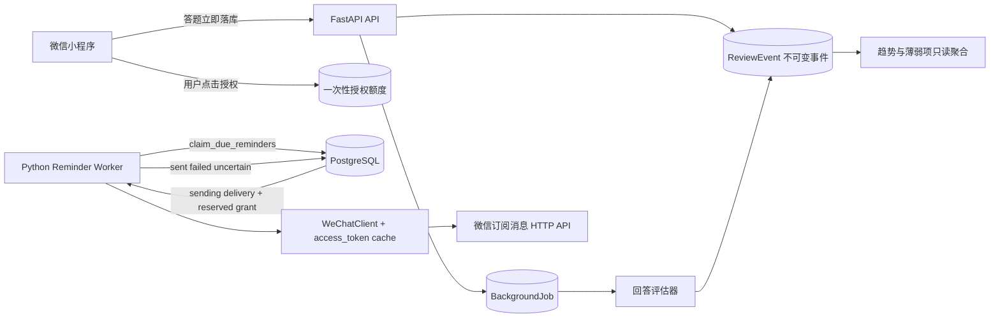

# 学习辅助模块：设计、部署与验收

本阶段包含三个彼此解耦的模块：微信订阅提醒、AI 回答评估、薄弱项与负载统计。数据库迁移为 `0005_learning_assistance`。



## 1. AI 回答评估

回答提交接口先写入 `answer_submitted` 和持久化后台任务，再返回 `pending`。小程序轮询评估结果，但四档评分按钮始终可用；模型超时或失败不会阻塞复习。

评估器只做一次短 Responses 请求，输出：

- 建议等级 `suggested_rating`（1–4）；
- 已覆盖要点与回答证据；
- 缺失要点和补充建议；
- 置信度与安全的模型用量元数据。

模型建议不会传给调度器。只有用户最终选择的 `rating` 会调用 FSRS；评分事件会记录当时的 AI 建议以及用户是否选择了不同等级。

云端建议配置：

```env
APP_ANSWER_EVALUATION_TIMEOUT_SECONDS=15
APP_ANSWER_EVALUATION_MAX_OUTPUT_TOKENS=1000
APP_ANSWER_EVALUATION_REASONING_EFFORT=none
APP_INLINE_WORKER=true
```

用户可在小程序“提醒”页关闭“回答后给出 AI 建议”。关闭后新回答不会创建模型任务，也不会产生模型调用成本。

## 2. 薄弱项、趋势与每日负载

接口：

- `GET /api/v1/review/insights?trend_days=30&forecast_days=14&weak_limit=10`
- `GET /api/v1/review/daily-plan?include_overflow=false`
- 原 `GET /api/v1/review/queue` 保留为“全部到期”入口。

薄弱分为 0–100，综合最近五次最终评分、累计遗忘率和可用的 FSRS difficulty。未复习卡单列为“未复习”，不会被误判成 0 分；逾期只代表紧迫性，不进入薄弱分。

趋势按用户时区做日桶并零填充。界面使用“自评掌握率”，不把用户评分包装成客观正确率。

每日上限是软上限：Learning / Relearning 到期卡可突破上限；其他超额卡进入“全部到期”。负载计算是只读推荐层，不写 `due_at`、`interval_days` 或 `scheduler_state`，也不会提前复习未来卡。

## 3. 微信一次性订阅提醒

### 3.1 创建真实模板

在微信公众平台为目标小程序选择一个订阅消息模板。模板需要能承载以下三个逻辑字段：

| 逻辑字段 | 后端内容 | 示例模板类型 |
| --- | --- | --- |
| `due_count` | 今日建议复习数量 | `number*` |
| `reminder_time` | 用户本地提醒时间 | `time*` |
| `summary` | 简短提醒摘要 | `thing*` |

实际字段名以“我的模板”页面为准，例如可能是 `number1`、`time2`、`thing3`。不要照抄示例，也不要把模板 ID 写入小程序源码。

### 3.2 配置后端与 Reminder Worker

订阅消息发送只使用微信官方 HTTP API，不需要 CloudBase 环境、套餐、云函数或 Cron。以下变量配置在 FastAPI API 与 Python Worker 共享的后端环境中；`APP_WECHAT_APP_SECRET` 只放在服务端环境变量，不写入小程序或仓库：

```env
APP_REMINDER_DELIVERY_ENABLED=true
APP_WECHAT_APP_ID=<mini-program-app-id>
APP_WECHAT_APP_SECRET=<mini-program-app-secret>
APP_WECHAT_SUBSCRIBE_TEMPLATE_ID=<real-template-id>
APP_WECHAT_SUBSCRIBE_PAGE=pages/review/review
WECHAT_TEMPLATE_FIELD_MAP_JSON={"due_count":"number1","reminder_time":"time2","summary":"thing3"}
APP_REMINDER_BATCH_SIZE=50
APP_REMINDER_LEASE_SECONDS=120
APP_REMINDER_WORKER_INTERVAL_SECONDS=60
APP_WECHAT_SEND_TIMEOUT_SECONDS=10
```

`APP_REMINDER_DELIVERY_ENABLED` 默认保持 `false`。只有 delivery 开关、模板 ID、AppID、AppSecret 都可用时，Worker 才会领取任务；`GET /api/v1/reminders/status` 也只有在这四类配置齐全时才显示发送能力已开启。

Compose 中 `api` 只负责 HTTP API，`worker` 同时运行既有 Agent 任务循环和 Reminder Worker。不要给 `worker` 配置多个副本；如果未来拆分部署，也保持只有一个 Reminder Dispatcher 实例。

### 3.3 运行链路与状态边界

```text
Reminder Worker（每 60 秒一次 tick）
→ claim_due_reminders()：按用户时区、preferred_time、due_at、每日去重领取
→ available grant 原子占用为 reserved，创建 sending delivery
→ WeChatClient 调用微信官方 subscribe/send
→ record_delivery_result() 写入 sent / failed / uncertain
```

- 微信返回 `errcode=0`：delivery 为 `sent`，一次性授权额度变为 `consumed`。
- 微信明确返回 `40037` 或 `43101`：delivery 为 `failed`，额度变为 `invalid`。
- 其他明确 `errcode`：delivery 为 `failed`，额度回到 `available`。
- token 获取网络失败、HTTP 超时或响应无法确认：delivery 为 `uncertain`，额度保持 `reserved`，不会自动重发。

`WeChatClient` 通过 `GET /cgi-bin/token` 获取 `access_token`，按 AppID 在进程内缓存，微信 `expires_in=7200` 时实际缓存约 7000 秒；遇到 `40001/40014/41001/42001` 会强制刷新并最多重试发送一次。当前项目没有 Redis 基础设施，因此没有引入 Redis，缓存只在单 Worker 进程内共享。

Worker 不再通过内部 HTTP 接口回调 FastAPI；旧的 `/api/v1/internal/reminders/dispatch/*` 和共享 dispatch token 已删除。定时调度、业务领取和发送都留在同一个 Python 服务层内，HTTP API 进程不被提醒发送阻塞。

### 3.4 本地与真机闭环验收

本地验收：

1. 在 `.env` 配置上文字段，并保持 `APP_REMINDER_DELIVERY_ENABLED=false` 启动数据库、API 和 Worker。
2. 创建/导入知识集并确认草稿，让至少一张复习卡到期。
3. 在小程序“提醒”页点击授权，确认可用次数增加。
4. 开启 `APP_REMINDER_DELIVERY_ENABLED=true` 并重启 Worker，把提醒时间临时调到当前时间之后 1 分钟内。
5. 观察 Worker 日志中的 `reminder worker tick`、`due reminders claimed`、`reminder delivery started`、微信 `errcode` 和 `delivery result`。
6. 查询 `reminder_deliveries` 与 `reminder_subscription_grants`，确认 `sent/consumed`；再等待一个 tick，确认同一用户、模板、本地日期不会重复发送。

真机验收必须由用户点击触发 `wx.requestSubscribeMessage`；开发者工具不能替代最终真机验证。真机收到消息后，可用次数减 1。模拟超时或结果回写中断时，任务应停留为 `uncertain`，不得自动重发。

## 当前验证边界

仓库自动化测试覆盖 Fake 模型评估、后台任务幂等、统计只读、提醒额度、发送去重、微信 HTTP 客户端、access_token 缓存与失效重试、Worker 异常恢复，以及 sent/failed/uncertain 对授权额度的影响。真实微信线上发送仍依赖你的小程序 AppID/AppSecret、实际模板字段和真机授权，未在本仓库中验证；完成上述真机步骤前，只能说“发送链路已实现并通过本地模拟验证”，不能声称“线上订阅消息已验证”。
